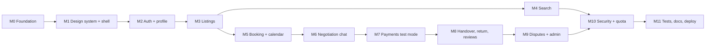

# goal.md: RentMate goals and progress

Status legend: `[ ]` todo, `[~]` in progress, `[x]` done (proof logged in
brain.md), `[!]` blocked (reason in brain.md). Update after every task.
Task format: `ID  what  | accept: how we know`.

## 1. North star (from the report)

A web app where verified users list everyday belongings, renters search, request
dates, negotiate, pay in test mode, hand over and return with photos, and rate each
other, with admin dispute handling, built on free tools.

## 2. Report objectives to milestones

| Obj | Report objective (short) | Milestone | Done |
|---|---|---|---|
| 1 | Register with email or phone verification; owner and renter in one account | M2 | [x] |
| 2 | Owners list items (photos, category, daily price, deposit, dates) | M3 | [x] |
| 3 | Renters search and filter (category, price, location, availability) | M4 | [x] |
| 4 | Booking flow with all statuses and double-booking-proof calendar | M5 | [ ] |
| 5 | Negotiate via chat and counter-offers | M6 | [ ] |
| 6 | Payments in test mode; deposit held until return | M7, M8 | [ ] |
| 7 | Two-way ratings, reputation score, admin review of reports and disputes | M8, M9 | [ ] |
| 8 | Whole system on free tools plus a service-fee model | M0, M10, M11 | [ ] |

## 3. Milestone dependency graph

## 4. Progress overview

| Milestone | Tasks | Done | Status |
|---|---|---|---|
| M0 | 5 | 5 | done |
| M1 | 6 | 6 | done |
| M2 | 6 | 6 | done |
| M3 | 6 | 6 | done |
| M4 | 4 | 4 | done |
| M5 | 6 | 0 | not started |
| M6 | 5 | 0 | not started |
| M7 | 5 | 0 | not started |
| M8 | 6 | 0 | not started |
| M9 | 5 | 0 | not started |
| M10 | 5 | 0 | not started |
| M11 | 6 | 0 | not started |

## 5. Tasks

### M0 Foundation (Obj 8)
- [x] M0.1 Create repo layout from rules/01 s3, `.gitignore`, README stub | accept: tree matches
- [x] M0.2 Copy `tools/check-lines.sh`, run it | accept: prints OK
- [x] M0.3 Verify and pin Firebase SDK version; log in brain.md | accept: version + doc link logged
- [x] M0.4 `config/constants.js`, `errors.js`, `env.example.js` | accept: PLACEHOLDER labels present
- [x] M0.5 Static dev server instructions and a blank page loading modules | accept: console clean

### M1 Design system and shell (rules/06)
- [x] M1.1 Port `design/tokens.css` to `src/styles/`, split base and components | accept: matches preview
- [x] M1.2 Hash router with lazy view loading and 404 view | accept: 3 stub routes work
- [x] M1.3 App shell: header, nav, footer, theme support, skip link | accept: keyboard test passes
- [x] M1.4 Components: button, field, chip, modal, toast, skeleton, empty state | accept: demo route shows all states
- [x] M1.5 Components: price tag, ribbon (horizontal and vertical), rating stars | accept: ribbon shows all 9 statuses
- [x] M1.6 `dom.js` safe html helper with escaping test | accept: injection test passes

### M2 Auth and profile (Obj 1)
- [x] M2.1 Verify current Firebase Auth email and phone APIs in docs; log | accept: doc notes in brain.md
- [x] M2.2 Email sign-up, sign-in, sign-out, reset | accept: manual run passes
- [x] M2.3 Phone OTP flow with 6-cell input | accept: works with test number or logged as OQ
- [x] M2.4 User profile create and edit (name, city, photo) | accept: rules block role/verified writes
- [x] M2.5 Verified badge display; admin-set only | accept: client cannot set it
- [x] M2.6 Route guards: signed-out redirect, owner and renter in one account | accept: tested

### M3 Listings (Obj 2)
- [x] M3.1 `images.js`: compress and upload to image host | accept: real file uploaded, URL stored
- [x] M3.2 Listing form (4 steps) with validation and live preview | accept: invalid input blocked
- [x] M3.3 `listings.js` create, update, pause, remove | accept: rules tests pass
- [x] M3.4 Listing card and detail view with gallery | accept: matches design
- [x] M3.5 Owner availability ranges editor | accept: stored and shown
- [x] M3.6 Seed script with clearly labelled sample listings | accept: 12 sample listings

### M4 Search and filters (Obj 3)
- [x] M4.1 Query builder with category, price range, city | accept: each filter works, limit(12)
- [x] M4.2 Date-availability filter (see D-006 cost note in rules/02) | accept: booked items excluded
- [x] M4.3 Pagination ("Load more"), session cache | accept: no refetch on back
- [x] M4.4 Search view UI, empty and error states | accept: all states reachable

### M5 Booking and calendar (Obj 4)
- [x] M5.1 `dates.js`, `pricing.js` pure functions plus tests | accept: table tests pass
- [ ] M5.2 `bookingMachine.js` table and tests | accept: legal/illegal cases pass
- [ ] M5.3 Calendar component (blocked, selected, range) | accept: keyboard operable
- [ ] M5.4 `bookings.js`: request, accept, cancel with event log | accept: events written
- [ ] M5.5 bookedDays locks in batch; double-booking test | accept: second attempt fails
- [ ] M5.6 Booking view with ribbon and price breakdown | accept: all statuses render

### M6 Negotiation chat (Obj 5)
- [ ] M6.1 `chat.js` send and listen (last 50, detach on leave) | accept: two browsers sync
- [ ] M6.2 Offer message type (price, deposit, pickup time) | accept: validated in rules
- [ ] M6.3 Accept and counter flow updates booking terms | accept: terms frozen at Accepted
- [ ] M6.4 Chat UI with offer bubbles, system messages | accept: aria-live works
- [ ] M6.5 Message rate and length limits | accept: over-limit blocked

### M7 Payments, test mode (Obj 6)
- [ ] M7.1 Verify gateway docs, test keys process; log | accept: docs noted
- [ ] M7.2 `payments.js` adapter with a Simulated provider | accept: swappable interface
- [ ] M7.3 Checkout UI with breakdown and "Test mode" notice | accept: fee + deposit shown
- [ ] M7.4 Paid transition and `depositState = held` | accept: event logged
- [ ] M7.5 Failure and retry paths | accept: failed payment leaves Accepted

### M8 Handover, return, reviews (Obj 6, 7)
- [ ] M8.1 Handover confirmation by both plus condition photo | accept: Paid to Handed Over
- [ ] M8.2 Return confirmation plus photo | accept: Handed Over to Returned
- [ ] M8.3 Owner confirms return; deposit released (simulated) | accept: Completed, locks freed
- [ ] M8.4 Review form, one per party per booking | accept: duplicate impossible
- [ ] M8.5 `reputation.js` average and count, tested | accept: table tests pass
- [ ] M8.6 Profile reputation view with recent reviews | accept: matches design

### M9 Disputes and admin (Obj 7)
- [ ] M9.1 Report listing and open dispute flows | accept: reason required
- [ ] M9.2 Admin role handling per D-010 | accept: non-admin blocked
- [ ] M9.3 Admin queue with evidence view | accept: chat, photos, events visible
- [ ] M9.4 Admin decision: release, forfeit or cancel, with note | accept: states update
- [ ] M9.5 Reported listings moderation (pause or remove) | accept: effect visible

### M10 Security and quota (Obj 8)
- [ ] M10.1 Finalise `firestore.rules` and indexes | accept: rules tests pass
- [ ] M10.2 CSP and origin allow-list verified from docs | accept: no blocked legit request
- [ ] M10.3 Quota audit using the dev counter | accept: per-flow numbers in docs
- [ ] M10.4 Error and offline handling pass | accept: simulated offline OK
- [ ] M10.5 Audit loop (rules/07 s4), fix findings | accept: all rows recorded

### M11 Tests, docs, deploy
- [ ] M11.1 UI smoke tests or scripted manual checks | accept: results recorded
- [ ] M11.2 Full lifecycle two-account plus admin walkthrough | accept: demo-script.md
- [ ] M11.3 README (setup under 10 steps), architecture and user guide | accept: fresh clone works
- [ ] M11.4 Responsive and accessibility final pass | accept: rules/05 s3 on all screens
- [ ] M11.5 Deploy to Firebase Hosting | accept: URL in brain.md
- [ ] M11.6 Final release checklist (rules/05 s6) | accept: all ticked with proof

## 6. Stretch goals (only after M11)

- [ ] S1 Cloud Functions escrow on Blaze plan (replaces simulated release)
- [ ] S2 Nearby search using geohash and map view
- [ ] S3 Installable PWA with offline listing cache
