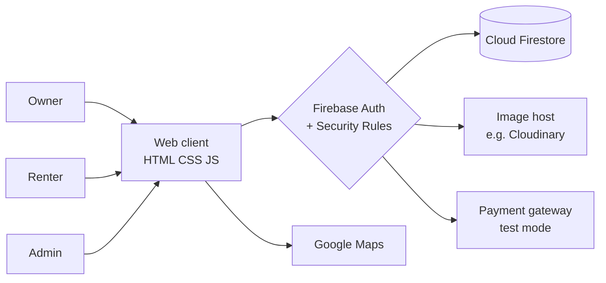
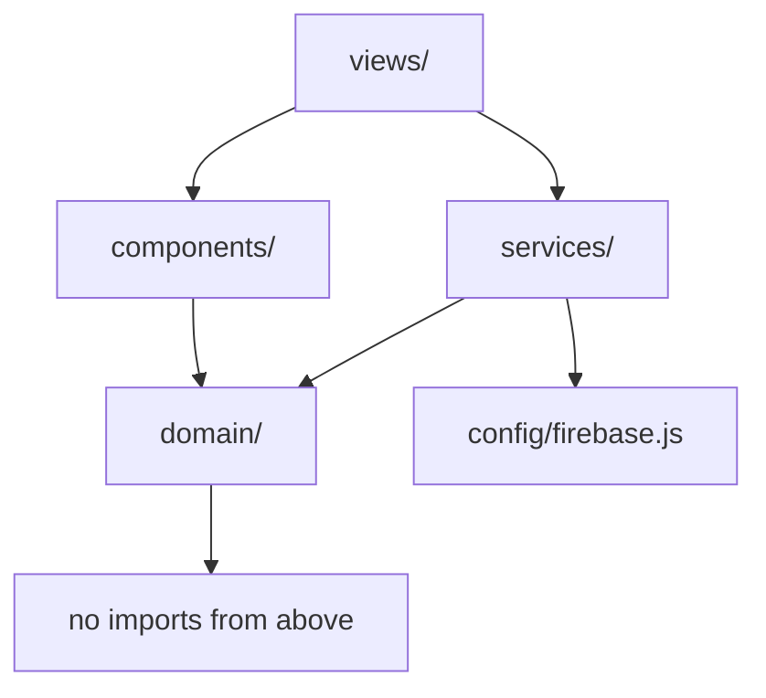

# 01 Architecture

## 1. System shape (from the report: 3 roles, 1 access gate, 3 services)



All three roles use the same client. Access is decided by Auth plus Security Rules.

## 2. Client architecture: layers and allowed imports



| Layer | Responsibility | May import |
|---|---|---|
| `domain/` | Pure logic: pricing, dates, status machine, reputation. No DOM, no Firebase | nothing |
| `services/` | All Firebase / gateway / image-host calls. Return plain objects | domain, config |
| `components/` | Reusable UI pieces (card, modal, calendar, stepper) | domain |
| `views/` | One screen each; wire services to components | all of the above |
| `app.js`, `router.js` | Boot and hash routing | views |

A view never calls Firebase directly. A service never touches the DOM.

## 3. Folder layout (create exactly this, add only when needed)

```
rentmate/
├─ index.html
├─ firebase.json  firestore.rules  firestore.indexes.json  .gitignore
├─ README.md
├─ src/
│  ├─ app.js  router.js
│  ├─ config/    firebase.js  constants.js  env.example.js
│  ├─ domain/    pricing.js  dates.js  bookingMachine.js  reputation.js
│  ├─ services/  auth.js listings.js bookings.js chat.js payments.js
│  │             reviews.js reports.js images.js users.js
│  ├─ components/ listingCard.js modal.js toast.js calendar.js
│  │              stepper.js ratingStars.js emptyState.js
│  ├─ views/     home.js auth.js search.js listingDetail.js listingForm.js
│  │             booking.js chat.js dashboard.js profile.js admin.js
│  └─ styles/    tokens.css base.css components.css views.css
├─ tests/        domain/*.test.js  rules/*.test.js
└─ docs/         architecture.md  user-guide.md  demo-script.md
```

Use ES modules in the browser (`<script type="module">`), no bundler required.
Run domain tests with Node's built-in test runner (`node --test`), so there is no
test framework to install.

## 4. Quota budget (Spark: 20,000 writes/day, 50,000 reads/day)

Design for these limits from day one. A shutdown mid-demo is the biggest risk.

1. Every query uses `limit()`. Default page size 12.
2. Listing cards show denormalised owner name, photo and rating stored on the
   listing, so a list needs 1 read per card, not 2.
3. No real-time listener on lists. Real-time only for: the open chat
   (last 50 messages) and the open booking document.
4. Detach listeners on route change. Tests must check this.
5. Cache listing pages in memory for the session; do not refetch on back navigation.
6. Each booking creates a bounded number of writes (see `rules/02`); log the
   count in `docs/architecture.md`.
7. Security-rule `get()` / `exists()` calls count as reads. Use them sparingly
   (see `rules/03`).
8. Add a dev-only read/write counter wrapper in `services/` that logs usage
   to the console, so quota use is visible while developing.

## 5. Images

- Compress in the browser before upload (target max 1600 px long edge, JPEG
  quality about 0.8; confirm the technique works on a real file).
- Upload to the external host with an unsigned upload preset (check the host's
  docs for the current mechanism). Store only the returned URL in Firestore.
- Max 5 photos per listing; condition photos at handover and return share the path.

## 6. Hosting and environments

- Firebase Hosting for the static client. Emulator suite for local dev when
  available (needs Java; if unavailable, log it as an Open question and test rules
  by reasoning plus a staging project).
- `config.local.js` (git-ignored) holds real keys; `env.example.js` is committed.

## 7. Known limitation to keep visible

Deposit release is simulated in test mode because safe release needs server-side
checks (Cloud Functions, Blaze plan). All money code goes behind
`services/payments.js` with a documented upgrade path in `docs/architecture.md`.
