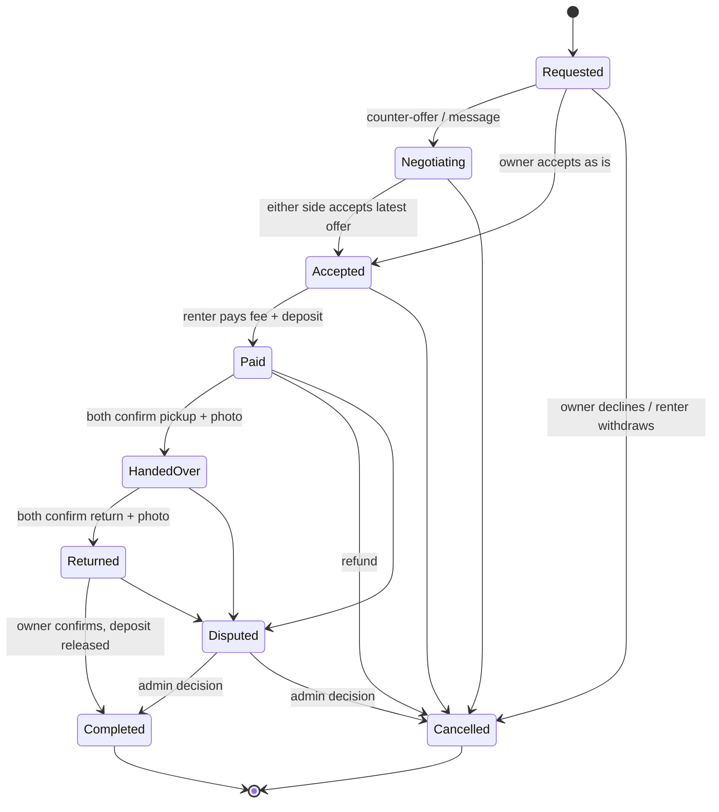

# 02 Booking Lifecycle, Calendar and Pricing

The report fixes the **list and order of statuses**. The exact transition table
below is a **proposed Decision (D-004)**; keep it in `src/domain/bookingMachine.js`
as a single data table so it is easy to change.

## 1. Status graph



Terminal states: Completed, Cancelled. Disputed is resolved only by an admin.

## 2. Transition table (who may do what)

| From | To | Actor | Guard |
|---|---|---|---|
| Requested | Negotiating | owner or renter | an offer or message exists |
| Requested | Accepted | owner | dates still free |
| Negotiating | Accepted | the party who did not make the latest offer | offer unexpired |
| Accepted | Paid | renter | payment success (test mode) |
| Paid | HandedOver | owner and renter | both confirmations stored |
| HandedOver | Returned | owner and renter | both confirmations stored |
| Returned | Completed | owner | none |
| any active | Cancelled | per rules in D-005 | status before Handed Over |
| Paid, HandedOver, Returned | Disputed | owner or renter | reason text required |
| Disputed | Completed or Cancelled | admin | decision note required |

`bookingMachine.canTransition(from, to, actor, ctx)` returns `{ ok, reason }`.
Every transition writes one event to `bookings/{id}/events` for the audit trail
(the admin uses it in disputes).

## 3. Calendar and double-booking prevention

Firestore rules cannot run range queries, so use per-day lock documents
(**Decision D-006**):

- `listings/{listingId}/bookedDays/{YYYY-MM-DD}` with `{ bookingId }`.
- On **Accepted**, one batched write creates the booking update plus one lock doc
  per night/day. Rules allow create only if the doc does not exist.
- On **Cancelled** or **Completed**, the locks are deleted in a batch.
- Before Accepted, availability is checked by reading `bookedDays` for the
  requested range only.
- Owner-set available dates live in `listings.availability` (ranges); a request
  outside them is rejected by `dates.js` and by rules where feasible.

Quota note: a 7-day rental costs about 7 lock writes plus the booking updates;
include this in the budget.

Day-count convention (Decision D-007, confirm in brain.md): inclusive start,
exclusive end, counted in whole days. Never use floating-point day math; use
integer dates in a fixed timezone (Asia/Kolkata unless decided otherwise).

## 4. Pricing (pure, integer, tested)

All money is stored as **integer paise** (Decision D-008) because gateways use
the smallest unit. Display as rupees with the `₹` symbol.

```
rental      = dailyPrice * days            (or the negotiated daily price)
serviceFee  = round(rental * FEE_RATE)     FEE_RATE is a PLACEHOLDER (OQ-001)
deposit     = listing.deposit              (or negotiated)
renterPays  = rental + serviceFee + deposit
ownerGets   = rental                       (fee wording to be confirmed, OQ-002)
```

Rules:
1. `FEE_RATE` lives in `config/constants.js`, labelled PLACEHOLDER until the
   team confirms the "small service fee" value.
2. Rounding: half-up on paise; tests for 1 day, 7 days, zero deposit, large values.
3. A counter-offer can change daily price, deposit or pickup time (report
   section 8, step 4). Each offer stores all three; the latest accepted offer
   becomes the booking's final terms (frozen at Accepted).
4. After Accepted, terms are immutable.

## 5. Handover, return and deposit

- Handover needs a condition photo from the owner and a confirmation from both.
- Return needs a condition photo from the renter side and the owner confirmation.
- Deposit states: `none -> held (at Paid) -> released | forfeited (admin)`.
- In test mode, "held" and "released" are recorded states plus a simulated
  gateway refund call. Label this in the UI ("Test mode: no real money moves").

## 6. Cancellation policy (OQ-003)

The report does not define refund rules. Until the team decides, implement the
minimal safe default as a **PLACEHOLDER** and log it:

- Before Paid: free cancel by either side.
- After Paid, before Handed Over: cancel allowed; full refund of rental, fee and
  deposit in test mode.
- After Handed Over: no cancel; use Dispute.

## 7. Tests required (in `tests/domain/`)

- Every legal and several illegal transitions, for each actor.
- Pricing: table-driven cases including rounding edges.
- Date ranges: overlap detection, inclusive/exclusive boundaries, past dates.
