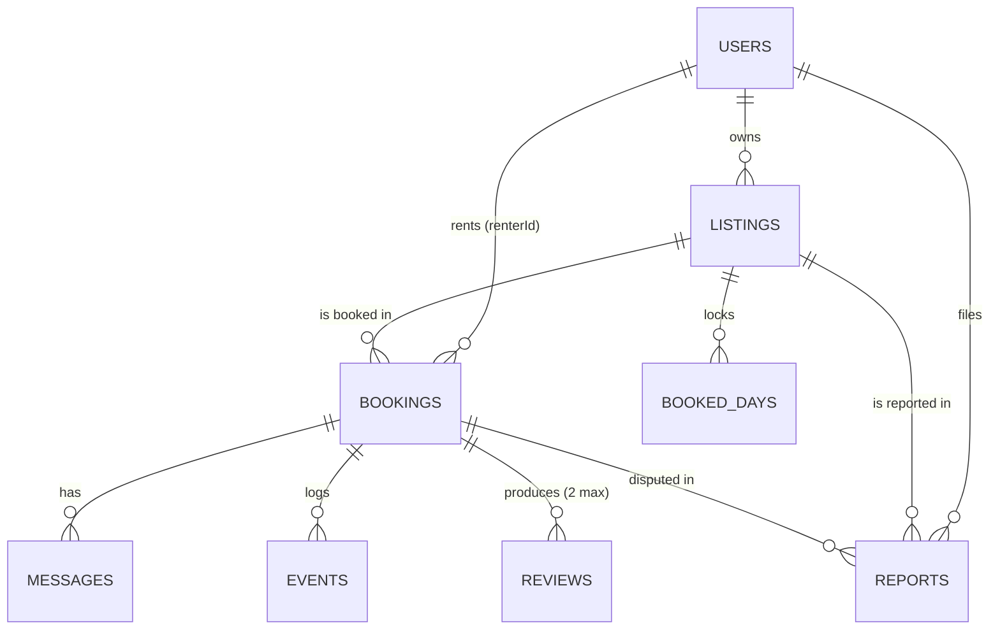

# 03 Data Model and Security

The report names the data areas ("users, listings, bookings, chats, reviews,
reports") but not the schema. The schema below is a **proposed Decision (D-009)**.
Change it only through a new decision entry in `brain.md`.

## 1. Collections

| Path | Key fields (all required unless noted) |
|---|---|
| `users/{uid}` | name, city, photoUrl (opt), verified (bool), role (`user`/`admin`), ratingAvg, ratingCount, createdAt |
| `listings/{id}` | ownerId, ownerName, ownerPhoto, ownerRating (denormalised), title, description, category, photos[], dailyPaise, depositPaise, city, geo (opt), availability[], status (`active`/`paused`/`removed`), createdAt |
| `listings/{id}/bookedDays/{YYYY-MM-DD}` | bookingId |
| `bookings/{id}` | listingId, ownerId, renterId, status, startDate, endDate, terms {dailyPaise, depositPaise, pickupTime}, amounts {rental, fee, deposit}, depositState, confirmations {...}, createdAt, updatedAt |
| `bookings/{id}/messages/{id}` | senderId, type (`text`/`offer`/`system`), text, offer {dailyPaise, depositPaise, pickupTime} (opt), createdAt |
| `bookings/{id}/events/{id}` | actorId, from, to, note (opt), createdAt |
| `reviews/{bookingId_authorId}` | bookingId, authorId, subjectId, rating (1-5), text, createdAt |
| `reports/{id}` | reporterId, kind (`listing`/`dispute`), listingId or bookingId, reason, status (`open`/`resolved`), decision (opt), createdAt |

Rules for the schema:
1. IDs for reviews are deterministic (`bookingId_authorId`) so a duplicate review is
   impossible by construction.
2. Denormalise only what lists need (owner name, photo, rating). When the owner
   changes profile, update their active listings in a batch (rare operation).
3. Store timestamps with server timestamps, dates as `YYYY-MM-DD` strings.
4. Max sizes: title 80 chars, description 1000, message 500, review 600.

## 2. Security Rules principles

Write `firestore.rules` as the **real** access gate, because the client is public.

1. Default deny. Open only what each rule below needs.
2. `users`: anyone signed in can read public fields; only the owner of the doc can
   write, and cannot set `verified`, `role`, `ratingAvg` or `ratingCount`.
3. `listings`: public read of `active` listings; only `ownerId == auth.uid` can
   create/update/delete; `ownerId` cannot change; validate types and sizes.
4. `bookings`: readable and writable only by `ownerId` or `renterId` (and admin).
   Status writes must follow the transition table in `rules/02` (validate
   `resource.data.status` to `request.resource.data.status` pairs and the actor).
5. `messages` and `events`: read by the two parties and admin; create only by a
   party who is the `senderId`; no update or delete.
6. `bookedDays`: create allowed only if the doc does not exist and the caller is
   the owner or the booking's renter; delete only by a party or admin.
7. `reviews`: create only by a party of a booking whose status is `Completed`,
   with `authorId == auth.uid`, once; no update after 14 days is a PLACEHOLDER
   (OQ-004); users cannot review themselves.
8. `reports`: create by signed-in users; read and update only by admin and the
   reporter (read).
9. Admin check: `get(/databases/$(database)/documents/users/$(request.auth.uid))
   .data.role == 'admin'`. Each use costs a read, so call it last in the
   boolean expression. Admin accounts are promoted manually in the console
   (Decision D-010) because custom claims need server code.

## 3. Verification and OTP

- Email or phone OTP is done by Firebase Authentication (check current
  docs for the phone-auth setup, free quota and test numbers before building).
- `verified` badge: set to true only by admin or a trusted flow; the client
  must never write it. Record the chosen flow in `brain.md` (OQ-005).

## 4. Client-side validation vs rules

Validate in the client for UX (immediately), and again in rules for safety.
Never rely on the client alone. A validation present only in the client is a bug.

## 5. Privacy

- Store the minimum personal data: name, city, photo, contact method from Auth.
- Do not show phone or email to the other party. Contact happens in-app chat.
- Precise addresses are shared only after status `Paid` (Decision D-011, change
  via `brain.md`). Before that, show city or area only.

## 6. Tests for rules

If the emulator is available, write rules tests in `tests/rules/` covering, at
minimum: unauthenticated read of a listing, non-owner edit of a listing, a renter
reading another booking, an illegal status jump, a duplicate review, a double
booking lock. Otherwise log the gap in `brain.md` and test manually with two
accounts, recording the steps in `docs/`.
