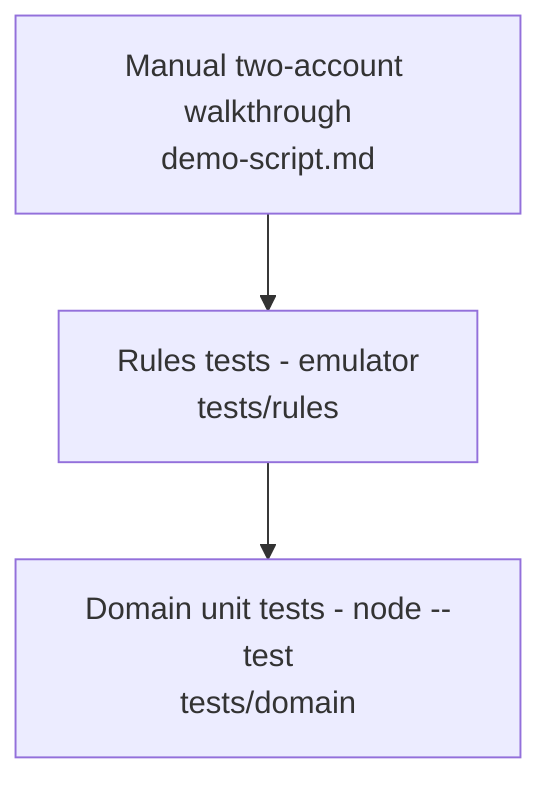
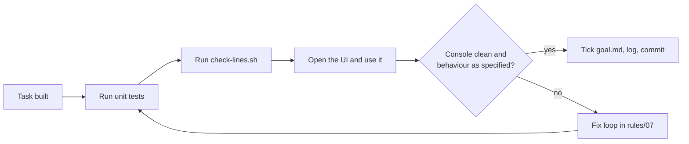

# 05 Testing, Verification and Definition of Done

## 1. Test pyramid for this project

| Layer | Tool | Must cover |
|---|---|---|
| Domain unit | `node --test` | pricing, dates, bookingMachine, reputation |
| Rules | Firebase emulator if available | cases in `rules/03` section 6 |
| UI smoke | Playwright (headless) if installable, else manual | each route loads, console has no errors, key flows |
| Walkthrough | two real accounts | full lifecycle, scripted in `docs/demo-script.md` |

## 2. Verify loop (run after every task)

## 3. What "opening the UI" means

1. Serve the app locally (any static server) and load the route.
2. Check the browser console: zero errors, zero warnings you introduced.
3. Exercise the happy path, then one failure path (bad input, offline).
4. Check at widths 360, 768 and 1280 px.
5. Tab through with the keyboard once; focus must be visible and logical.
6. If screenshots are possible, take them and compare with the intended design in
   `design/design-preview.html`. Note differences in `brain.md`.

## 4. Test-writing rules

- Test behaviour, not implementation. Table-driven tests for pure functions.
- A bug fix starts with a failing test that reproduces it.
- Tests never depend on the network or real time (inject a clock).
- No test file over 250 lines; split by feature.

## 5. Definition of done (per task)

- [ ] Behaviour matches `goal.md` acceptance line
- [ ] Unit tests added or updated and passing (command output seen)
- [ ] UI states done: loading, empty, error, success
- [ ] Keyboard and screen-reader basics pass (labels, focus, contrast)
- [ ] `tools/check-lines.sh` passes
- [ ] No secrets, no console errors, no dead code
- [ ] `goal.md` ticked, `brain.md` updated, commit made

## 6. Final release checklist (project done)

- [ ] Every objective 1-8 in `goal.md` mapped table is satisfied with proof
- [ ] Full lifecycle walkthrough passes with two accounts plus an admin
- [ ] Double-booking attempt from two browsers fails safely
- [ ] A non-owner cannot edit a listing; a stranger cannot read a chat
- [ ] Quota estimate documented; no unbounded query exists (search the code)
- [ ] Every screen reviewed at 360, 768, 1280 px, in light and dark if supported
- [ ] README explains setup in under 10 steps and states "test mode" clearly
- [ ] `docs/` complete: architecture, user guide, demo script
- [ ] All Open questions in `brain.md` are answered or listed in the README
- [ ] Deployed to Firebase Hosting, URL recorded in `brain.md`

## 7. Reporting honesty

If something was not tested, say "not tested" and why. Never write "should work".
Distinguish clearly: *verified by running*, *verified by reading*, *assumed*.
