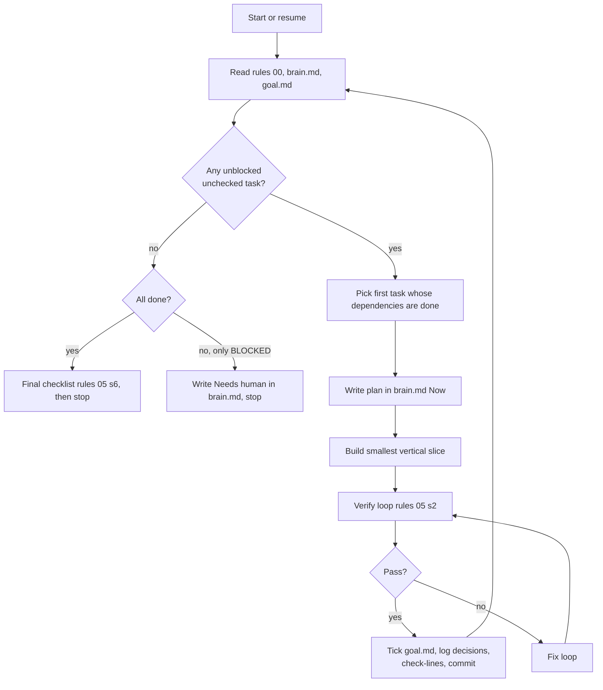
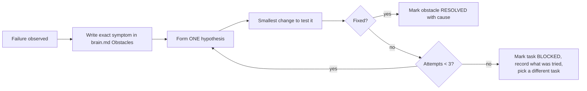

# 07 Loop Protocol

How to keep working until the project is finished, without drifting or looping
forever.

## 1. The outer loop (one task per turn of the loop)

## 2. The fix loop (bounded)

Rules:
1. Each attempt needs a **new** hypothesis. Repeating the same change is not an attempt.
2. Read the actual error and the relevant docs before the second attempt.
3. After 3 failed attempts, step back: is the design wrong? Log options in
   brain.md. A blocked task never stops the whole project.
4. Come back to BLOCKED tasks after finishing every unblocked one.

## 3. The milestone loop (every milestone end)

1. Run all tests and `tools/check-lines.sh`.
2. Walk the milestone's feature in the browser as a user. Screenshot if possible.
3. Re-read the relevant report objective; confirm the acceptance line truthfully.
4. Update `goal.md` progress and `brain.md` "Current state" (5 lines).
5. Refactor pass (max 20% of the milestone's effort): remove duplication, split
   any file past 200 lines, delete dead code.
6. Commit and tag `m<N>-done`.

## 4. The audit loop (before M11 and again at the end)

Check each item and record the result (not "looks fine"):

| Audit | How |
|---|---|
| Size cap | `tools/check-lines.sh` |
| Quota | grep for `getDocs(`/`onSnapshot(`; each has `limit()` or a reason |
| Security | rules tests or two-account manual run |
| Secrets | grep for key patterns; `.gitignore` covers config.local.js |
| Hallucination | every external API call traced to a doc page noted in brain.md |
| UI | rules/06 section 11 on every screen |

## 5. Anti-drift guards

- Never start a task not in `goal.md`. New idea -> add as a task or Open question first.
- Never change the stack (report-fixed). Propose in brain.md instead and continue.
- If a task grows past about 250 lines of code or one sitting, split it into subtasks
  in `goal.md` before continuing.
- Every 5 tasks, re-read the report facts in `rules/00` section 2 and compare
  with what is built. Fix divergence immediately.

## 6. Context and session hygiene

- Keep the working set small: read only the files for the current task.
- Before the context gets long, write current state to `brain.md`:
  Current focus, next 3 steps, files being edited, anything not yet committed.
- At session start after a break: boot sequence, then `git status` and `git log
  -5` to reconcile reality with brain.md. The repo wins on conflict.

## 7. When to ask a human (only these)

1. Credentials or accounts only a person can create.
2. A report ambiguity that changes the product and cannot be defaulted safely
   (log as Open question, choose a PLACEHOLDER, continue; ask only if it blocks).
3. A destructive or irreversible action (deleting data, publishing to production
   with real payments).
Everything else: decide, log the Decision with the reason, and proceed.

## 8. Parallel work (optional, for tools that support sub-agents)

Safe to run in parallel: domain tests, CSS components, docs, seed script.
Not safe in parallel: security rules and the booking service (shared contract).
Each sub-agent gets one task id, the relevant rule files, and must report in the
format of MASTER_PROMPT section 7. The lead agent alone edits `goal.md`/`brain.md`.
